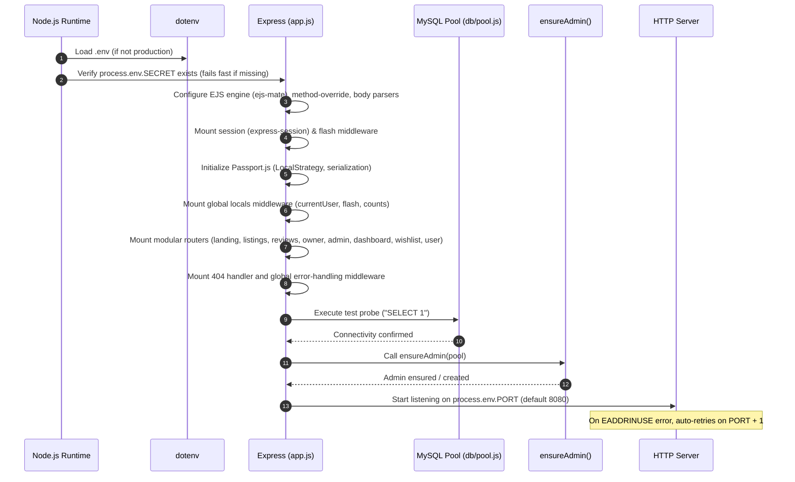

<!-- Generated: 2026-11-04 · Commit: e6bb127 · Branch: db-fix-owner-documents · DB schema version: 004_listing_coordinates_check -->
# WanderLust System Architecture

## 1. Application Boot Sequence

The server boots in `app.js` following this strict sequence:

---

## 2. Global Middleware Stack (in Execution Order)

Every incoming HTTP request passes through the global middleware pipeline defined in `app.js`:

| Order | Middleware | Source (File:Line) | Purpose & Configuration |
|:---:|---|---|---|
| 1 | `methodOverride("_method")` | `app.js:24` | Allows HTML forms to simulate `PUT` and `DELETE` requests via query/body parameter `_method`. |
| 2 | `express.json()` | `app.js:25` | Parses incoming JSON request payloads (e.g., AJAX wishlist requests). |
| 3 | `express.urlencoded({ extended: true })` | `app.js:26` | Parses URL-encoded form submissions into `req.body`. |
| 4 | `express.static(path.join(__dirname, "public"))` | `app.js:29` | Serves public static files (CSS, JS, images). |
| 5 | `session(sessionOptions)` | `app.js:41` | Cookie session with `httpOnly: true`, `sameSite: "lax"`, 1-week `maxAge`, signed using `process.env.SECRET`. |
| 6 | `flash()` | `app.js:42` | Flash message buffer attached to the session (`req.flash()`). |
| 7 | `passport.initialize()` | `app.js:45` | Initializes Passport authentication context on the request. |
| 8 | `passport.session()` | `app.js:46` | Restores login session from session store using `passport.deserializeUser`. |
| 9 | Custom Locals Middleware | `app.js:77-92` | Injects `res.locals.success`, `res.locals.error`, `res.locals.info`, `res.locals.currentUser`, `res.locals.canManageListings` (`isApprovedOwner(req.user)`), and `res.locals.pendingOwnerCount` (for admins). |
| 10 | Route Dispatchers | `app.js:95-117` | Directs requests to matched routes. |
| 11 | 404 Not Found Handler | `app.js:120-122` | Catches unmatched requests and generates `new ExpressError(404, "Page not found")`. |
| 12 | Global Error Handler | `app.js:125-128` | Renders `error.ejs` with `statusCode` (default 500) and `message`. |

---

## 3. View Engine & Layout Setup

- **Engine:** EJS (`ejs`) integrated with `ejs-mate` as the layout engine (`app.js:23`).
- **Views Directory:** `views/` (`app.js:28`).
- **Primary Layout:** `views/layouts/boilerplate.ejs`
  - Includes navbar (`views/includes/navbar.ejs`), flash container (`views/includes/flash.ejs`), and footer (`views/includes/footer.ejs`).
  - Loads Bootstrap 5.3 CSS, FontAwesome 6, Google Fonts (Plus Jakarta Sans), and custom stylesheets (`/css/style.css`, `/css/theme.css`).
  - Loads Bootstrap bundle JS, client scripts (`/js/script.js`, `/js/ui.js`).
- **Dashboard Layout:** `views/dashboard/layout.ejs` (extends `boilerplate.ejs`, embeds `views/dashboard/sidebar.ejs`).
- **Global `res.locals` Available to All Views:**
  - `currentUser`: Deserialized user object (`{ id, username, email, role, ownerStatus, profilePictureUrl, phone, bio }`) or `undefined`.
  - `canManageListings`: Boolean indicating whether `currentUser` is an approved owner (`utils/permissions.js:15`).
  - `pendingOwnerCount`: Integer count of pending owner applications (evaluated for admins via `OwnerProfile.countsByStatus()`).
  - `success`, `error`, `info`: Arrays of flash messages.

---

## 4. Authentication, Session & User Lifecycle

- **Library:** Passport.js (`passport-local` strategy) paired with `bcryptjs`.
- **Password Hashing:** `bcrypt.hash(password, 10)` generates a 60-character salted hash (`$2a$10$...`) stored in `users.password_hash`.
- **Verification:** `bcrypt.compare(password, user.passwordHash)` (`app.js:54`).
- **Serialization:** Stores only `user.id` into `req.session.passport.user` (`app.js:68`).
- **Deserialization:** Executes `User.findById(id)` on every authenticated request (`app.js:69-75`), refreshing user data, role, and current `ownerStatus` directly from the database.
- **Session Configuration (`app.js:32-40`):**
  - Secret: `process.env.SECRET` (mandatory).
  - Cookie: `httpOnly: true`, `sameSite: "lax"`, `maxAge: 604800000` (7 days).
  - Storage: Default MemoryStore (note: in production, a persistent Redis or MySQL session store is recommended).

---

## 5. Database Connection & Pool Management

- **Driver:** `mysql2/promise` (`db/pool.js:5`).
- **Configuration Parameters:**
  - Host: `process.env.DB_HOST || "127.0.0.1"`
  - Port: `Number(process.env.DB_PORT) || 3306`
  - User: `process.env.DB_USER || "root"`
  - Password: `process.env.DB_PASSWORD || ""`
  - Database: `process.env.DB_NAME || "wanderlust"`
  - Pool Limits: `waitForConnections: true`, `connectionLimit: 10`, `queueLimit: 0`
  - Type Formatting: `decimalNumbers: true` (ensures `DECIMAL(10,2)` columns parse as JS numbers).
  - Charset: `utf8mb4`
- **Transactions API:** Transactions are executed using standard `conn = await pool.getConnection()`, `await conn.beginTransaction()`, `await conn.commit()`, and `await conn.rollback()` with `conn.release()` inside `finally` blocks (e.g. `controller/user.js:57-103`, `models/ownerProfile.js:70-134`).

---

## 6. Environment Variables Reference

| Variable | Used In | Purpose | Required? | Default / Notes |
|---|---|---|:---:|---|
| `PORT` | `app.js:152` | Web server listening port | No | `8080` (auto-increments if port is busy) |
| `SECRET` | `app.js:9, 33` | Session encryption signing key | **YES** | Fails fast with exit code 1 if missing (`app.js:10`) |
| `DB_HOST` | `db/pool.js:8` | MySQL server hostname or IP | No | `127.0.0.1` |
| `DB_PORT` | `db/pool.js:9` | MySQL port | No | `3306` |
| `DB_USER` | `db/pool.js:10` | Database login username | No | `root` |
| `DB_PASSWORD` | `db/pool.js:11` | Database password | No | `""` (empty string) |
| `DB_NAME` | `db/pool.js:12` | Database schema name | No | `wanderlust` |
| `CLOUD_NAME` | `cloudConfig.js:6` | Cloudinary account cloud name | **YES** | Required for media uploads |
| `CLOUD_API_KEY` | `cloudConfig.js:7` | Cloudinary API access key | **YES** | Required for media uploads |
| `CLOUD_API_SECRET` | `cloudConfig.js:8` | Cloudinary API secret | **YES** | Required for asset management & destruction |
| `MAP_TOKEN` | `controller/listings.js:4`, `views/listings/show.ejs:104` | Mapbox GL API public token | **YES** | Used for forward geocoding & client map rendering |
| `ADMIN_USERNAME` | `db/ensureAdmin.js:6`, `controller/dashboard.js:17` | Single static admin username | No | `"admin"` |
| `ADMIN_EMAIL` | `db/ensureAdmin.js:7` | Single static admin email | No | `"admin@wanderlust.test"` |
| `ADMIN_PASSWORD` | `db/ensureAdmin.js:8` | Single static admin initial password | No | `"Admin@12345"` (min 8 characters) |

---

## 7. External Cloud Services

### 7.1 Cloudinary (Media & Document Storage)
- **Library:** `cloudinary` (v1.41.3) + `multer-storage-cloudinary` (v4.0.0).
- **Listing Images (`cloudConfig.js:11-17`):**
  - Storage: CloudinaryStorage instance targeting folder `wanderlust`.
  - Allowed Formats: `jpeg`, `png`, `jpg`.
  - Managed via `upload.single("image")`.
- **User Avatars (`cloudConfig.js:19-37`):**
  - Storage: Targeting folder `wanderlust/avatars`.
  - Allowed Formats: `jpeg`, `png`, `jpg`, `webp`.
  - Size Limit: `2 * 1024 * 1024` (2 MB).
- **Owner Legal Documents (`cloudConfig.js:42-133`):**
  - Storage: MemoryStorage buffer processed by custom `uploadBufferToCloudinary()`.
  - Target Folder: `wanderlust/owner-documents`.
  - Allowed MIME Types: `application/pdf`, `image/jpeg`, `image/png`, `image/jpg`.
  - Resource Type: `raw` for PDF files, `auto` for images.
  - Size Limit: `5 * 1024 * 1024` (5 MB per file, up to 5 files).
- **Asset Destruction (`cloudConfig.js:135-142`):**
  - Function: `deleteCloudinaryAsset(publicId, resourceType)`.
  - Invoked during user deletion (`models/user.js:264`), listing deletion (`models/listing.js:337`), and avatar updates (`controller/dashboard.js:90`).

### 7.2 Mapbox (Geocoding & Interactive Maps)
- **Library:** `@mapbox/mapbox-sdk` (v0.16.2) on backend; Mapbox GL JS (v3.1.2) on client.
- **Server-Side Geocoding (`controller/listings.js:68-85`):**
  - Method: `forwardGeocode({ query: location, limit: 1 })`.
  - Extracts `[longitude, latitude]` coordinates and persists them into `listings.longitude` and `listings.latitude`.
  - Validates coordinate presence; fails gracefully with flash redirect if location cannot be matched.
- **Client-Side Rendering (`public/js/map.js`):**
  - Progressive on-demand loading: user clicks "View Interactive Map" button to initialize Mapbox container, avoiding unneeded client bandwidth.

