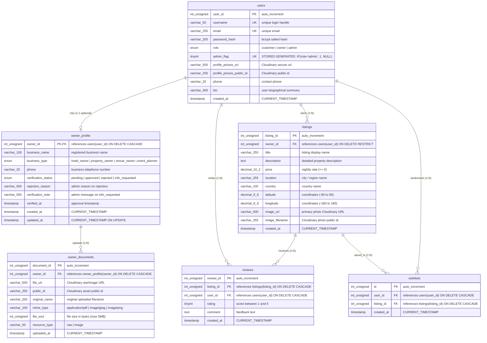
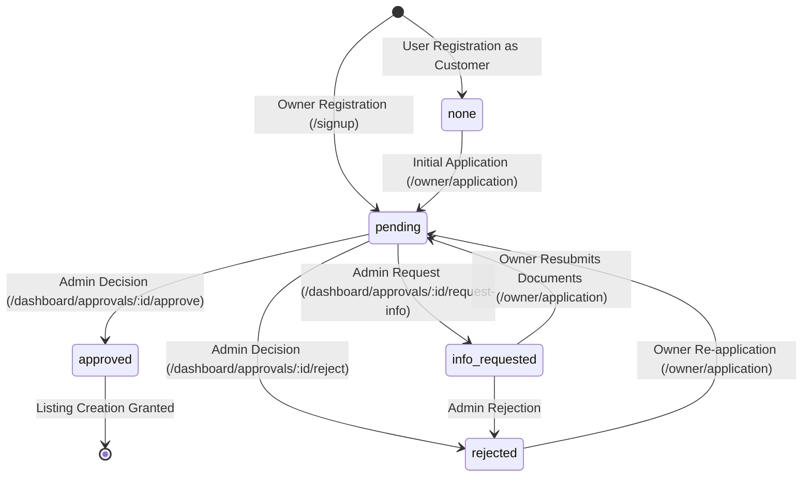

<!-- Generated: 2026-11-04 · Commit: e6bb127 · Branch: db-fix-owner-documents · DB schema version: 004_listing_coordinates_check -->
# WanderLust Database Documentation

## 1. Relational Architecture & ER Diagram

---

## 2. Table-by-Table Schema Specification

### 2.1 `users`
- **Purpose:** Stores authenticated user accounts for customers, property owners, and administrators.
- **Engine:** InnoDB · **Collation:** `utf8mb4_0900_ai_ci` · **Live Row Count:** 23
- **Columns:**
  - `user_id` (INT UNSIGNED, PK, AUTO_INCREMENT): Unique user identifier.
  - `username` (VARCHAR(50), NOT NULL, UNIQUE `uq_users_username`): User's unique handle.
  - `email` (VARCHAR(255), NOT NULL, UNIQUE `uq_users_email`): Primary contact and recovery address.
  - `password_hash` (VARCHAR(255), NOT NULL): Salted bcrypt hash (`$2a$10$...`).
  - `role` (ENUM('customer','owner','admin'), NOT NULL, DEFAULT 'customer'): Security role.
  - `admin_flag` (TINYINT, STORED GENERATED, UNIQUE `uq_single_admin`): Evaluated as `IF(role = 'admin', 1, NULL)`. Enforces a single administrator system-wide.
  - `profile_picture_url` (VARCHAR(500), NULL): Cloudinary delivery URL for user avatar.
  - `profile_picture_public_id` (VARCHAR(255), NULL): Cloudinary public identifier for avatar asset deletion.
  - `phone` (VARCHAR(20), NULL): Personal contact telephone.
  - `bio` (VARCHAR(300), NULL): User biography/profile summary.
  - `created_at` (TIMESTAMP, NOT NULL, DEFAULT CURRENT_TIMESTAMP): Account registration timestamp.

### 2.2 `owner_profile`
- **Purpose:** Stores business verification and application state for property owners (1:1 extension of `users`).
- **Engine:** InnoDB · **Collation:** `utf8mb4_0900_ai_ci` · **Live Row Count:** 15
- **Columns:**
  - `owner_id` (INT UNSIGNED, PK, FK `fk_owner_profile_user` -> `users.user_id` ON DELETE CASCADE): User ID of the owner.
  - `business_name` (VARCHAR(100), NOT NULL): Commercial trading name.
  - `business_type` (ENUM('hotel_owner','property_owner','venue_owner','event_planner'), NOT NULL): Entity classification.
  - `phone` (VARCHAR(20), NULL): Direct business contact phone.
  - `verification_status` (ENUM('pending','approved','rejected','info_requested'), NOT NULL, DEFAULT 'pending', INDEX `idx_owner_profile_status`): Operational review state.
  - `rejection_reason` (VARCHAR(500), NULL): Explanation provided by admin upon rejection.
  - `verification_note` (VARCHAR(500), NULL): Request message provided by admin when seeking additional information.
  - `verified_at` (TIMESTAMP, NULL): Timestamp when status transitioned to 'approved'.
  - `created_at` (TIMESTAMP, NOT NULL, DEFAULT CURRENT_TIMESTAMP): Profile creation timestamp.
  - `updated_at` (TIMESTAMP, NOT NULL, DEFAULT CURRENT_TIMESTAMP ON UPDATE CURRENT_TIMESTAMP): Last modification timestamp.

### 2.3 `owner_documents` (1NF Normalized Table)
- **Purpose:** Stores uploaded legal and identity verification documents submitted by property owners.
- **Engine:** InnoDB · **Collation:** `utf8mb4_0900_ai_ci` · **Live Row Count:** 3
- **Columns:**
  - `document_id` (INT UNSIGNED, PK, AUTO_INCREMENT): Unique document primary key.
  - `owner_id` (INT UNSIGNED, NOT NULL, FK `fk_owner_documents_owner` -> `owner_profile.owner_id` ON DELETE CASCADE, INDEX `idx_owner_documents_owner`): Associated owner.
  - `file_url` (VARCHAR(500), NOT NULL): Secure Cloudinary access URL.
  - `public_id` (VARCHAR(255), NULL): Cloudinary public asset identifier for deletion.
  - `original_name` (VARCHAR(255), NULL): Original client filename (e.g. `business_permit.pdf`).
  - `mime_type` (VARCHAR(100), NULL): File MIME type (`application/pdf`, `image/jpeg`, `image/png`).
  - `file_size` (INT UNSIGNED, NULL): File payload size in bytes.
  - `resource_type` (VARCHAR(50), NULL): Cloudinary resource type (`raw` for PDF, `image` for photos).
  - `uploaded_at` (TIMESTAMP, NOT NULL, DEFAULT CURRENT_TIMESTAMP): Timestamp of upload.

### 2.4 `listings`
- **Purpose:** Accommodation and venue rental offerings published by verified owners.
- **Engine:** InnoDB · **Collation:** `utf8mb4_0900_ai_ci` · **Live Row Count:** 54
- **Columns:**
  - `listing_id` (INT UNSIGNED, PK, AUTO_INCREMENT): Primary key.
  - `owner_id` (INT UNSIGNED, NOT NULL, FK `fk_listing_owner` -> `users.user_id` ON DELETE RESTRICT, INDEX `idx_listings_owner`): Owner user ID.
  - `title` (VARCHAR(255), NOT NULL): Listing title.
  - `description` (TEXT, NOT NULL): Full textual description.
  - `price` (DECIMAL(10,2), NOT NULL, CHECK `chk_listing_price` `price >= 0`): Nightly rate.
  - `location` (VARCHAR(255), NOT NULL): City or destination locality.
  - `country` (VARCHAR(100), NOT NULL): Country name.
  - `latitude` (DECIMAL(9,6), NULL, CHECK `chk_listing_lat` `latitude IS NULL OR latitude BETWEEN -90 AND 90`): Geocoded latitude.
  - `longitude` (DECIMAL(9,6), NULL, CHECK `chk_listing_lng` `longitude IS NULL OR longitude BETWEEN -180 AND 180`): Geocoded longitude.
  - `image_url` (VARCHAR(500), NOT NULL): Cloudinary delivery URL for cover image.
  - `image_filename` (VARCHAR(255), NULL): Cloudinary public identifier for listing cover image.
  - `created_at` (TIMESTAMP, NOT NULL, DEFAULT CURRENT_TIMESTAMP): Date published.

### 2.5 `reviews`
- **Purpose:** User feedback and rating scores for accommodations.
- **Engine:** InnoDB · **Collation:** `utf8mb4_0900_ai_ci` · **Live Row Count:** 3
- **Columns:**
  - `review_id` (INT UNSIGNED, PK, AUTO_INCREMENT): Primary key.
  - `listing_id` (INT UNSIGNED, NOT NULL, FK `fk_review_listing` -> `listings.listing_id` ON DELETE CASCADE, INDEX `idx_reviews_listing`): Listing reviewed.
  - `user_id` (INT UNSIGNED, NOT NULL, FK `fk_review_user` -> `users.user_id` ON DELETE CASCADE, INDEX `fk_review_user`): Author user ID.
  - `rating` (TINYINT, NOT NULL, CHECK `chk_review_rating` `rating BETWEEN 1 AND 5`): Numerical rating.
  - `comment` (TEXT, NOT NULL): Review text.
  - `created_at` (TIMESTAMP, NOT NULL, DEFAULT CURRENT_TIMESTAMP): Review creation timestamp.

### 2.6 `wishlists`
- **Purpose:** Saved accommodation bookmarks curated by users.
- **Engine:** InnoDB · **Collation:** `utf8mb4_0900_ai_ci` · **Live Row Count:** 6
- **Columns:**
  - `id` (INT UNSIGNED, PK, AUTO_INCREMENT): Surrogate key.
  - `user_id` (INT UNSIGNED, NOT NULL, FK `fk_wishlist_user` -> `users.user_id` ON DELETE CASCADE): User bookmarking.
  - `listing_id` (INT UNSIGNED, NOT NULL, FK `fk_wishlist_listing` -> `listings.listing_id` ON DELETE CASCADE, INDEX `idx_wishlists_listing`): Target listing.
  - `created_at` (TIMESTAMP, NOT NULL, DEFAULT CURRENT_TIMESTAMP): Bookmark timestamp.
  - **Unique Key:** `uq_user_listing` (`user_id`, `listing_id`) prevents duplicate bookmarks.

---

## 3. State Machines & Enumerations

### 3.1 `owner_profile.verification_status` State Machine

#### Transition Specification:
| Current Status | Target Status | Triggering Actor | Endpoint | Changed DB Columns | Gating Effect |
|---|---|---|---|---|---|
| *None* | `pending` | Owner | `POST /owner/application` | `verification_status='pending'`, `created_at=NOW()` | Cannot add listings. Redirected to `/owner/status`. |
| `pending` | `approved` | Admin | `POST /dashboard/approvals/:id/approve` | `verification_status='approved'`, `verified_at=NOW()`, `rejection_reason=NULL`, `verification_note=NULL` | Can access `/listings/new` and publish listings immediately. |
| `pending` | `rejected` | Admin | `POST /dashboard/approvals/:id/reject` | `verification_status='rejected'`, `verified_at=NULL`, `rejection_reason=reason` | Cannot add listings. Status page renders rejection reason & re-apply form. |
| `pending` | `info_requested` | Admin | `POST /dashboard/approvals/:id/request-info` | `verification_status='info_requested'`, `verification_note=message` | Cannot add listings. Status page renders request note & document resubmission form. |
| `info_requested` | `pending` | Owner | `POST /owner/application` | `verification_status='pending'`, `verification_note=NULL`, inserts new rows to `owner_documents` | Re-enters admin review queue. |
| `rejected` | `pending` | Owner | `POST /owner/application` | `verification_status='pending'`, `rejection_reason=NULL`, inserts new rows to `owner_documents` | Re-enters admin review queue. |

---

## 4. Invariants & Data Integrity Rules

| Rule / Invariant | Enforcement Mechanism | Failure Consequence | Verified Code / SQL Citation |
|---|---|---|---|
| Single Admin in System | **DB-enforced:** `users.admin_flag` UNIQUE constraint (`uq_single_admin`) | MySQL error `ER_DUP_ENTRY` if second user has role='admin' | `db/schema.sql:11, 20` |
| No Duplicate Bookmarks | **DB-enforced:** `wishlists.uq_user_listing` (`user_id`, `listing_id`) | MySQL error `ER_DUP_ENTRY` on duplicate bookmark | `db/schema.sql:100` |
| Valid Review Rating (1-5) | **DB & App-enforced:** `chk_review_rating` (`rating BETWEEN 1 AND 5`) + Joi validation | DB rejection + Joi 400 error | `db/schema.sql:86`, `utils/validateReview.js:14` |
| Non-Negative Listing Price | **DB & App-enforced:** `chk_listing_price` (`price >= 0`) + Joi `min(0)` | DB rejection + Joi 400 error | `db/schema.sql:70`, `schema.js:17` |
| Coordinate Bounds | **DB-enforced:** `chk_listing_lat` ([-90, 90]), `chk_listing_lng` ([-180, 180]) | DB rejection if invalid coordinates passed | `db/schema.sql:71, 72` |
| Listing Deletion Cascades | **DB-enforced:** `fk_review_listing` and `fk_wishlist_listing` ON DELETE CASCADE | Automatically purges reviews and wishlist items | `db/schema.sql:88, 104` |
| User Deletion Safety | **DB & App-enforced:** `fk_listing_owner` ON DELETE RESTRICT | Cannot delete user if listings exist without prior cleanup | `db/schema.sql:73`, `models/user.js:287` |
| Owner Approval Before Listing | **App-enforced only ⚠️:** Middleware `isApprovedOwner` checks `user.role === 'owner' && user.ownerStatus === 'approved'` | Redirects with flash error to `/owner/status` or `/listings` | `middleware.js:65-89`, `utils/permissions.js:15` |
| Owner Profile Exclusive to Owners | **App-enforced only ⚠️:** Registration logic and `requireRole('owner')` middleware | No DB check constraint prevents non-owner from having profile | `routes/owner.js:16, 23`, `controller/user.js:50` |

---

## 5. Query Inventory

| Model Function | File:Line | Target Tables | SQL Operation | Transaction? | Invoking Controller / Routes |
|---|---|---|---|:---:|---|
| `User.create` | `models/user.js:46` | `users` | `INSERT INTO users` | Optional (used in Tx) | `controller/user.js:60` (`POST /signup`) |
| `User.findByUsername` | `models/user.js:77` | `users`, `owner_profile` | `SELECT ... LEFT JOIN owner_profile` | No | Passport LocalStrategy (`app.js:52`), `controller/dashboard.js:70` |
| `User.findById` | `models/user.js:109` | `users`, `owner_profile` | `SELECT ... LEFT JOIN owner_profile` | No | Passport deserializeUser (`app.js:70`), `controller/dashboard.js:40, 88, 324` |
| `User.findAllFiltered` | `models/user.js:192` | `users`, `owner_profile`, `listings` | `SELECT ... LEFT JOIN ... GROUP BY u.user_id` | No | `controller/dashboard.js:288` (`GET /dashboard/users`) |
| `User.deleteUser` | `models/user.js:259` | `users`, `listings`, `owner_profile` | Multi-step DELETE + Cloudinary destruction | Yes (stepwise) | `controller/dashboard.js:382` (`DELETE /dashboard/users/:id`) |
| `OwnerProfile.create` | `models/ownerProfile.js:65` | `owner_profile`, `owner_documents` | `INSERT INTO owner_profile`, `INSERT INTO owner_documents` | Yes | `controller/user.js:72`, `controller/owner.js:54` |
| `OwnerProfile.findByUserId` | `models/ownerProfile.js:141` | `owner_profile`, `owner_documents` | `SELECT FROM owner_profile`, `SELECT FROM owner_documents` | Optional | `controller/owner.js:18`, `controller/admin.js:43`, `controller/dashboard.js:200, 259` |
| `OwnerProfile.reapply` | `models/ownerProfile.js:172` | `owner_profile`, `owner_documents` | `UPDATE owner_profile`, `INSERT INTO owner_documents` | Yes | `controller/owner.js:61` (`POST /owner/application`) |
| `OwnerProfile.requestInfo` | `models/ownerProfile.js:257` | `owner_profile` | `UPDATE owner_profile SET verification_status='info_requested'` | No | `controller/admin.js:114`, `controller/dashboard.js:277` |
| `OwnerProfile.setDecision` | `models/ownerProfile.js:277` | `owner_profile` | `UPDATE owner_profile SET verification_status=?` | No | `controller/admin.js:51, 84`, `controller/dashboard.js:208, 240` |
| `OwnerProfile.listByStatus` | `models/ownerProfile.js:306` | `owner_profile`, `users`, `owner_documents` | `SELECT ... JOIN users`, batched `SELECT ... WHERE owner_id IN (...)` | No | `controller/admin.js:24`, `controller/dashboard.js:172` |
| `OwnerProfile.countsByStatus` | `models/ownerProfile.js:353` | `owner_profile` | `SELECT SUM(...)` status aggregate counts | No | `app.js:84`, `controller/admin.js:25`, `controller/dashboard.js:173` |
| `Listing.findAll` | `models/listing.js:66` | `listings`, `owner_profile`, `reviews` | `SELECT ... LEFT JOIN ... GROUP BY ... ORDER BY` | No | `controller/listings.js:14`, `routes/landing.js:22` |
| `Listing.findByIdWithDetails` | `models/listing.js:127` | `listings`, `users`, `reviews` | `SELECT ... LEFT JOIN users`, `SELECT ... JOIN users` (reviews) | No | `controller/listings.js:43` (`GET /listings/:id`) |
| `Listing.create` | `models/listing.js:203` | `listings` | `INSERT INTO listings` | No | `controller/listings.js:88` (`POST /listings`) |
| `Listing.update` | `models/listing.js:239` | `listings` | `UPDATE listings SET ...` | No | `controller/listings.js:132` (`PUT /listings/:id`) |
| `Listing.deleteWithImage` | `models/listing.js:331` | `listings` | Cloudinary destroy + `DELETE FROM listings` | No | `controller/listings.js:174`, `controller/dashboard.js:399` |
| `Review.create` | `models/review.js:14` | `reviews` | `INSERT INTO reviews` | No | `controller/reviews.js:14` (`POST /listings/:id/reviews`) |
| `Review.remove` | `models/review.js:46` | `reviews` | `DELETE FROM reviews` | No | `controller/reviews.js:23` (`DELETE /listings/:id/reviews/:reviewId`) |
| `Wishlist.add` | `models/wishlist.js:18` | `wishlists` | `INSERT INTO wishlists ... ON DUPLICATE KEY UPDATE` | No | `controller/wishlist.js:34` (`POST /wishlist/:listingId`) |
| `Wishlist.remove` | `models/wishlist.js:32` | `wishlists` | `DELETE FROM wishlists WHERE user_id=? AND listing_id=?` | No | `controller/wishlist.js:58` (`DELETE /wishlist/:listingId`) |
| `Wishlist.getUserWishlist` | `models/wishlist.js:44` | `wishlists`, `listings`, `owner_profile`, `reviews` | `SELECT ... JOIN listings LEFT JOIN ... GROUP BY` | No | `controller/dashboard.js:112` (`GET /dashboard/wishlist`) |

---

## 6. Seed Scripts Evaluation

1. **`db/seed.js`:**
   - **Invocation:** `npm run seed` or `node db/seed.js`.
   - **Behavior:** Reads `db/schema.sql`, executes table creations, wipes existing listings/reviews, creates seed user `seeduser`, upserts approved `owner_profile`, inserts 10 sample international listings with geocoded coordinates, and executes `ensureAdmin()`.
   - **Idempotency:** Safe to run repeatedly; cleans up listings before reinserting.

2. **`seed/seed.sql` & `seed/generate-seed.js`:**
   - **Invocation:** `npm run seed:owners`.
   - **Behavior:** Creates 10 verified owner profiles (`@seed.wanderlust.test`) with 5 localized listings each (50 total listings) across regional clusters (Rajasthan, Coorg, Goa, Tuscany, Bali, Swiss Alps, Paris, Dubai, Kerala, Himachal).
   - **Compliance:** Inserts into `users`, `owner_profile`, and `listings` without referencing legacy columns. Cleans up existing `@seed.wanderlust.test` users inside a transaction (`START TRANSACTION ... COMMIT`).

