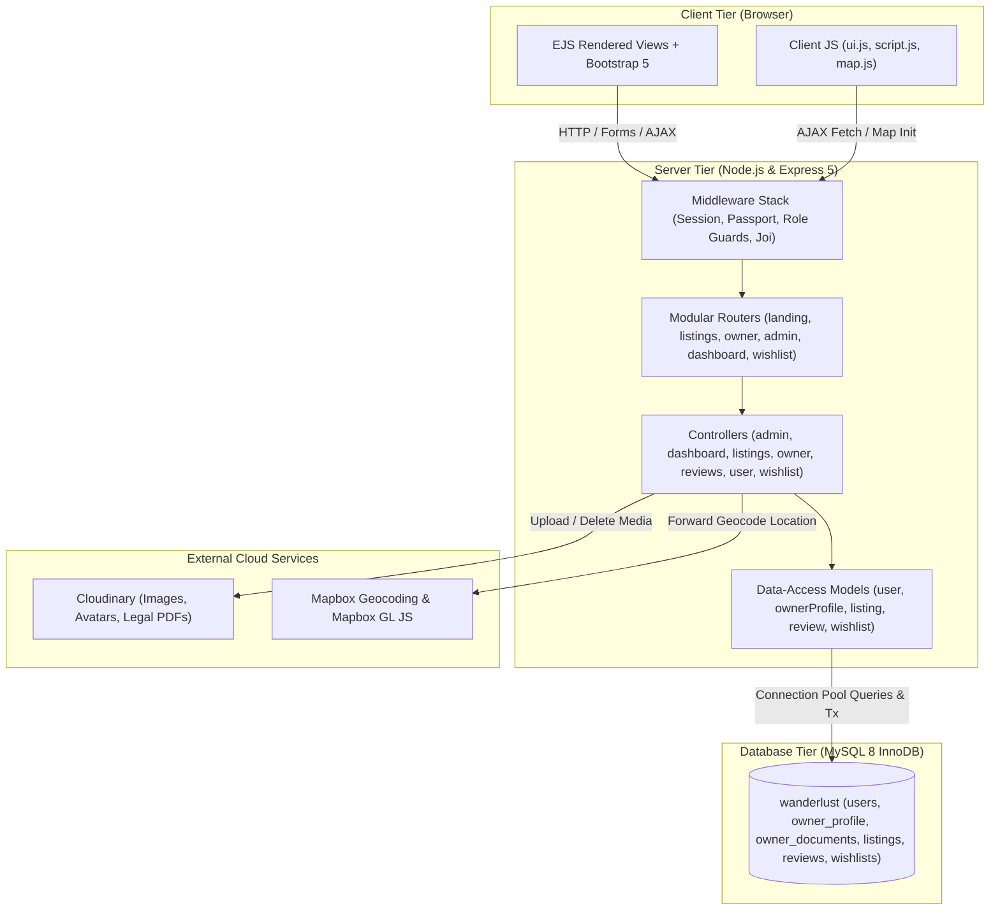

<!-- Generated: 2026-11-04 · Commit: e6bb127 · Branch: db-fix-owner-documents · DB schema version: 004_listing_coordinates_check -->
# WanderLust — Project Context Master Document

## 1. Project Purpose & High-Level Overview
**WanderLust** is a production-grade, full-stack vacation rental and accommodation management platform engineered using Node.js, Express, MySQL, and EJS. The platform connects travelers seeking vacation accommodations with verified property hosts, governed by an administrative verification and moderation layer.

Unlike unverified classifieds or informal rental boards, WanderLust enforces mandatory host onboarding compliance, requiring prospective property owners to submit commercial registration details and valid legal verification documents (PDF/JPG/PNG) before publishing listings. Administrators evaluate credentials through a specialized moderation dashboard with tools to approve, reject, or request supplementary information. Once verified, owners can create, update, and manage lodging catalogs complete with geocoded mapping coordinates and cloud-hosted imagery. Customers can discover stays through multi-parameter searches, filter by price thresholds or lodging types, curate interactive wishlists, and publish reviews.

---

## 2. Technical Stack Summary

| Layer | Technologies & Libraries | Version / Source |
|---|---|---|
| **Backend Runtime** | Node.js | v20+ / v22.19.0 |
| **Web Framework** | Express.js | `^5.1.0` |
| **Database & Driver** | MySQL 8.0+ via `mysql2/promise` connection pool | `^3.11.0` |
| **Templating Engine** | EJS + `ejs-mate` layout engine | `^3.1.10`, `^4.0.0` |
| **Frontend Framework** | Bootstrap 5, FontAwesome 6, Plus Jakarta Sans font | `^5.3.8`, CDN |
| **Authentication** | Passport.js (`passport-local`), `bcryptjs`, `express-session` | `^0.7.0`, `^2.4.3`, `^1.18.2` |
| **Validation** | Joi object schema validation | `^18.0.2` |
| **Cloud Storage** | Cloudinary API + `multer-storage-cloudinary` + Multer | `^1.41.3`, `^4.0.0`, `^2.0.2` |
| **Geocoding & Maps** | Mapbox SDK (backend forward geocoding) + Mapbox GL JS (client) | `^0.16.2` |
| **Testing Suite** | Node.js native test runner (`node --test`), Supertest | `^7.0.0` (185 tests passing) |

---

## 3. High-Level Architecture Diagram



---

## 4. How to Run Locally

### 4.1 Prerequisites
- Node.js (v20 or higher)
- MySQL Server 8.0+ running on `127.0.0.1:3306`
- Cloudinary developer account credentials
- Mapbox public access token

### 4.2 Configuration
Create a local `.env` file in `major/` based on `.env.example`:
```env
PORT=8080
SECRET=your_secure_session_signing_secret
DB_HOST=127.0.0.1
DB_PORT=3306
DB_USER=root
DB_PASSWORD=your_mysql_password
DB_NAME=wanderlust
CLOUD_NAME=your_cloudinary_name
CLOUD_API_KEY=your_cloudinary_key
CLOUD_API_SECRET=your_cloudinary_secret
MAP_TOKEN=your_mapbox_public_token
ADMIN_USERNAME=admin
ADMIN_EMAIL=admin@wanderlust.test
ADMIN_PASSWORD=Admin@12345
```

### 4.3 Setup & Execution Commands
```bash
# Install dependencies
npm install

# Initialize database schema and base seeds
npm run seed

# (Optional) Seed 10 multi-category owners with 50 localized listings
npm run seed:owners

# Run comprehensive automated test suite (185 tests)
npm test

# Start the application server
npm start
# Server listens on http://localhost:8080 (auto-increments if port is in use)
```

---

## 5. Directory Map

```text
major/
├── app.js                       # Server entry point, middleware chain, router mounting
├── cloudConfig.js               # Cloudinary configuration, Multer storage engines & upload handlers
├── middleware.js                # Core security guards (isLoggedIn, isApprovedOwner, isOwner, requireRole)
├── schema.js                    # Joi validation schemas (listingSchema, profileSchema)
├── package.json                 # Project dependencies, scripts, engines
├── config/
│   └── dashboardSections.js     # Role-based dashboard navigation metadata
├── controller/                  # Business logic handlers
│   ├── admin.js                 # Standalone admin owner approval controller
│   ├── dashboard.js             # Central dashboard controller (approvals, users, listings, profile)
│   ├── listings.js              # Accommodation CRUD and search/filter logic
│   ├── owner.js                 # Owner application and status handlers
│   ├── reviews.js               # Customer rating and feedback handlers
│   ├── user.js                  # Authentication, registration, and session management
│   └── wishlist.js              # Bookmark addition/removal handlers
├── db/
│   ├── ensureAdmin.js           # Idempotent single-admin bootstrap routine
│   ├── migrate.js               # Database schema migration runner
│   ├── migrations/              # Up/down SQL migration scripts (001 to 004)
│   ├── pool.js                  # MySQL2 connection pool configuration
│   ├── schema.sql               # Canonical database schema definition
│   └── seed.js                  # Re-runnable database seeder
├── docs/
│   ├── context/                 # Comprehensive documentation suite (generated context)
│   └── db-audit/                # Database audit and 1NF normalization records
├── models/                      # Pure data-access layer (parameterized queries)
│   ├── listing.js               # Accommodation listings query methods
│   ├── ownerProfile.js          # Owner profiles and normalized owner_documents methods
│   ├── review.js                # Accommodation feedback query methods
│   ├── user.js                  # User accounts and administrative management queries
│   └── wishlist.js              # Wishlist bookmark query methods
├── public/                      # Static client assets
│   ├── css/                     # style.css, theme.css (tokens & styling), rating.css
│   ├── images/                  # High-res graphics (landing, login, signup, role cards)
│   └── js/                      # script.js (form validation), ui.js (enhancements), map.js (Mapbox)
├── routes/                      # Express route definitions
│   ├── admin.js                 # /admin/owners routes
│   ├── dashboard.js             # /dashboard/* routes
│   ├── landing.js               # / root route
│   ├── listing.js               # /listings/* routes
│   ├── owner.js                 # /owner/* routes
│   ├── review.js                # /listings/:id/reviews/* routes
│   ├── user.js                  # /login, /signup, /logout routes
│   └── wishlist.js              # /wishlist/* routes
├── seed/                        # Extended seed generator and multi-owner SQL
├── tests/                       # Automated test matrix (185 tests)
├── utils/                       # ExpressError, permissions, roles, wrapAsync, validators
└── views/                       # EJS UI templates
    ├── admin/                   # Legacy admin owners view
    ├── dashboard/               # Approvals, users, listings, profile, wishlist, bookings views
    ├── includes/                # Navbar, footer, flash alert partials
    ├── layouts/                 # boilerplate.ejs, dashboard/layout.ejs
    ├── listings/                # Index catalog, show details, new/edit forms
    ├── owner/                   # status.ejs portal
    └── users/                   # signup.ejs and login.ejs authentication views
```

---

## 6. Roles & Access Control Summary

The platform enforces three distinct user roles via database enumeration `ENUM('customer','owner','admin')` and application middleware:

1. **Customer (Traveler / Guest):**
   - Default role upon self-registration.
   - Can explore all listings, filter, inspect details, add properties to a personal Wishlist, and post/delete their own reviews.
   - Cannot create, edit, or delete accommodation listings.

2. **Property Owner:**
   - Registers with commercial business details and mandatory legal documentation.
   - Initial operational status is `pending`. Gated from publishing listings until approved.
   - When `status === 'approved'`, granted full CRUD privileges over their personal accommodation listings.
   - Can monitor application progress, review admin feedback, and resubmit documents on `/owner/status`.

3. **Administrator:**
   - Exactly one administrator exists system-wide (enforced by `uq_single_admin` on `admin_flag`).
   - Evaluates owner applications, inspects legal documents, issues approvals, rejections (with reason), or information requests (with note).
   - Manages all registered users (search, filter, view details, and execute cascading deletions).
   - Can remove any non-compliant accommodation listing across the platform.

---

## 7. Domain Model Summary

- **`users`:** Central identity table storing credentials (`password_hash`), role, avatar, and contact info. Candidate keys: `{user_id}`, `{username}`, `{email}`.
- **`owner_profile`:** 1:1 extension of `users` storing trading details, verification status (`pending`, `approved`, `rejected`, `info_requested`), and admin feedback notes.
- **`owner_documents`:** 1:N normalized child table (1NF compliant) storing metadata and Cloudinary URLs for uploaded legal credentials.
- **`listings`:** Accommodation properties containing title, description, price, city location, country, coordinates (`latitude`, `longitude`), and cover photos.
- **`reviews`:** Numerical ratings (1-5) and feedback comments linked to listings and author users.
- **`wishlists`:** Bookmarks linking customers to saved listings with a unique composite key `(user_id, listing_id)` preventing duplicate entries.

---

## 8. Key Domain Workflows Overview

1. **User Onboarding & Authentication:** Customers and owners register via `/signup`. Passwords are validated for complexity and hashed via bcrypt. Login uses Passport.js local strategy with secure HTTP-only session cookies.
2. **Owner Legal Verification:** Prospective hosts upload 1-5 legal files during signup. Files are stored in Cloudinary `wanderlust/owner-documents` and indexed in `owner_documents`. Status defaults to `pending`.
3. **Administrative Moderation:** Admins review applicants on `/dashboard/approvals`, inspect documents in a modal viewer, and approve, reject, or request info.
4. **Owner Document Resubmission:** If info is requested or rejected, owners upload supplementary documents via `/owner/status`, returning status to `pending`.
5. **Accommodation Publishing:** Approved owners create listings on `/listings/new`. Locations are forward-geocoded via Mapbox SDK, images are uploaded to Cloudinary, and records are inserted with coordinate bounds validation.
6. **Discovery & Wishlist:** Visitors browse the catalog on `/listings` with real-time category filtering and price sorting. Customers toggle bookmarks via asynchronous AJAX requests (`/wishlist/:id`).
7. **Feedback & Ratings:** Customers submit ratings (1-5) and comments on `/listings/:id/reviews`. System computes aggregate rating scores and displays feedback transparently.
8. **Administrative Oversight:** Admins manage all platform users on `/dashboard/users` with live role filters, pagination, and safe cascading deletion routines that purge database rows and Cloudinary assets.

---

## 9. Current Design System & UI State

The application features a modern, clean design system built on **Bootstrap 5.3**, custom CSS variables (`theme.css`), and the **Plus Jakarta Sans** font.
- Redesign complete across: Landing page (`landing.ejs`), Authentication views (`login.ejs`, `signup.ejs`), Owner status portal (`owner/status.ejs`), and Dashboard consoles (`approvals.ejs`, `users.ejs`, `listings.ejs`, `wishlist.ejs`, `profile.ejs`).
- The user interface incorporates progressive enhancements via `public/js/ui.js` (sticky header shadow, role selector cards, password visibility toggles, interactive tax switches, and AJAX wishlist buttons).

---

## 10. Non-Negotiable Invariants

1. **Owner Listing Gating:** Route mutation operations (`POST /listings`, `PUT /listings/:id`, `DELETE /listings/:id`) MUST be protected by `isApprovedOwner` requiring `role === 'owner' && ownerStatus === 'approved'`.
2. **Single Administrator Constraint:** Database constraint `uq_single_admin` on `admin_flag` guarantees exactly one admin user. The main admin cannot be deleted.
3. **Cloud Asset Synchronization:** Whenever records with Cloudinary assets (listings, avatars, owner documents) are removed, the remote Cloudinary files must be explicitly deleted.
4. **Normalized 1NF Documents:** Owner verification files must be inserted as individual rows in `owner_documents`, never as a JSON column in `owner_profile`.

---

## 11. Links to Detailed Reference Documents

- [Detailed Architecture & Runtime (`ARCHITECTURE.md`)](file:///c:/a-warehouse/major_phase2/major/docs/context/ARCHITECTURE.md)
- [Database Schema & Query Inventory (`DATABASE.md`)](file:///c:/a-warehouse/major_phase2/major/docs/context/DATABASE.md)
- [Route Inventory & Security Matrix (`ROUTES.md`)](file:///c:/a-warehouse/major_phase2/major/docs/context/ROUTES.md)
- [End-to-End Domain Workflows (`WORKFLOWS.md`)](file:///c:/a-warehouse/major_phase2/major/docs/context/WORKFLOWS.md)
- [Frontend Views & Forms Contract (`FRONTEND.md`)](file:///c:/a-warehouse/major_phase2/major/docs/context/FRONTEND.md)
- [Coding Conventions & Developer Checklist (`CONVENTIONS.md`)](file:///c:/a-warehouse/major_phase2/major/docs/context/CONVENTIONS.md)
- [Drift Report (`DRIFT_REPORT.md`)](file:///c:/a-warehouse/major_phase2/major/docs/context/DRIFT_REPORT.md)
- [Risks & Technical Debt (`RISKS_AND_DEBT.md`)](file:///c:/a-warehouse/major_phase2/major/docs/context/RISKS_AND_DEBT.md)
- [Open Questions for Repository Owner (`OPEN_QUESTIONS.md`)](file:///c:/a-warehouse/major_phase2/major/docs/context/OPEN_QUESTIONS.md)
- [Future Agent Orientation Guide (`AGENT_GUIDE.md`)](file:///c:/a-warehouse/major_phase2/major/docs/context/AGENT_GUIDE.md)

