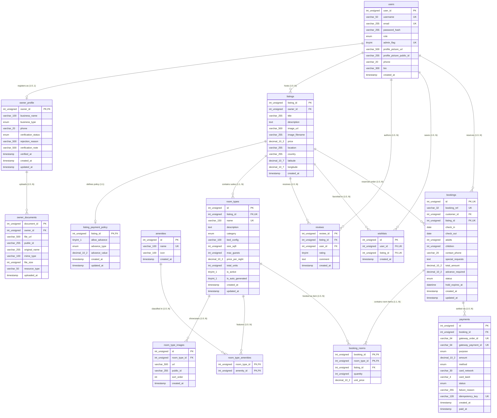

# WanderLust — Final Relational Entity-Relationship Diagram

**Database:** `wanderlust` (MySQL 8.0.43 InnoDB)  
**Schema Composition:** 14 Tables + 1 View (`booking_summary`)  
**Hardened State:** Composite Foreign Keys, Domain Check Constraints, Restrict Delete Rules  

---

## 1. Complete Relational ER Diagram (Mermaid)

---

## 2. Cardinality & Referential Rules Summary

| Parent Entity | Child Entity | Cardinality | Foreign Key / Referential Action | Business Semantics |
|---|---|:---:|---|---|
| `users` | `owner_profile` | `1 : 0..1` | `owner_id -> users.user_id` (CASCADE) | User account optionally holds an approved/pending owner identity. |
| `owner_profile` | `owner_documents` | `1 : 0..N` | `owner_id -> owner_profile.owner_id` (CASCADE) | Legal KYC verification files uploaded by owner applicants. |
| `users` | `listings` | `1 : 0..N` | `owner_id -> users.user_id` (RESTRICT) | Hosts cannot delete their account while active listings exist. |
| `listings` | `listing_payment_policy`| `1 : 1` | `listing_id -> listings.listing_id` (CASCADE) | 1:1 extension table configuring advance payment requirements. |
| `listings` | `room_types` | `1 : 1..N` | `listing_id -> listings.listing_id` (CASCADE) | Suites/rooms belonging to the property. |
| `room_types` | `room_type_images` | `1 : 0..N` | `room_type_id -> room_types.id` (CASCADE) | Gallery photos specific to each room category. |
| `room_types` | `amenities` | `M : N` | Resolved via `room_type_amenities` (CASCADE/CASCADE) | Multi-valued amenity assignments per room type. |
| `users` | `bookings` | `1 : 0..N` | `customer_id -> users.user_id` (RESTRICT) | Customers with historical bookings cannot be wiped from the DB. |
| `listings` | `bookings` | `1 : 0..N` | `listing_id -> listings.listing_id` (RESTRICT) | Properties with booking records cannot be deleted. |
| `bookings` | `booking_rooms` | `1 : 1..N` | `(booking_id, listing_id) -> bookings(id, listing_id)` (CASCADE) | Composite foreign key ensuring room items belong to reservation. |
| `room_types` | `booking_rooms` | `1 : 0..N` | `(room_type_id, listing_id) -> room_types(id, listing_id)` (RESTRICT) | Composite foreign key preventing cross-listing room booking. |
| `bookings` | `payments` | `1 : 0..N` | `booking_id -> bookings.id` (RESTRICT) | Immutable financial payment records cannot be deleted with booking. |

---

## 3. SQL View Specification: `booking_summary`

`booking_summary` is a server-side SQL view that provides safe, pre-calculated booking and balance totals for customer and host dashboards:
- Performs `LEFT JOIN payments` on `bookings.id`.
- Sums only successful payments (`status = 'success'`).
- Dynamically outputs:
  - `amount_paid`: Total funds successfully collected to date.
  - `balance_due`: Remaining balance (`GREATEST(0, total_amount - amount_paid)`).
  - `payment_status`: Computed enum representation (`unpaid`, `partially_paid`, `paid`).
